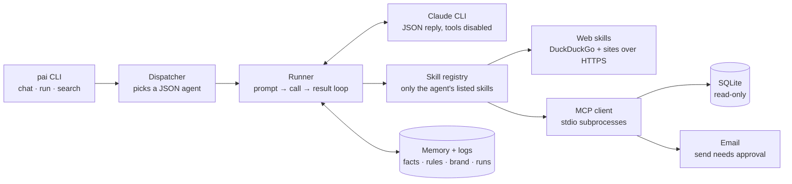

# personal ai

A small assistant that starts out **dumb** and **learns as you use it**.
Five agents, each with a few skills. It can create new agents on its own, and one agent
(the trainer) rewrites the other agents' system prompts when you tell it how they should behave.
The model backend is the `claude` CLI (Claude Code) called in print mode; nothing else.

```
agents/          one JSON file per agent (name, description, skills, instructions = its system prompt)
agents/history/  automatic backups of every instruction change (revert with `pai revert <agent>`)
memory/facts.md  everything the AI has learned (one bullet per line, edit freely)
memory/rules.md  standing rules that go into every agent's prompt ("always answer in British English")
memory/brand.md  the brand guide; goes into every agent's prompt (edit by hand)
index/           hybrid search index (index.db) and sources.txt, the list of files/folders it covers
                 (copy index/sources.example.txt to index/sources.txt and add your own paths)
data/business.db the business database the `db` connector reads (SQLite, read-only)
mcp.json         the MCP connectors (email, db) and how to start them
approvals/       queue of actions waiting for your approval (sending email)
workspace/       where the writer saves files by default
logs/runs.jsonl  one line per run: agent, task, skills used, answer, what was learned
logs/search.jsonl one line per search: what was retrieved and what the reranker kept
examples/        a sample .txt and .pdf to try the reader on
personal_ai/     llm.py (claude wrapper), skills.py, agents.py, memory.py, runner.py,
                 index.py (hybrid search), mcp.py (MCP client/server), approvals.py, connectors/
scripts/         import_leads.py seeds data/business.db from the Praxos leads workbook
tests/           offline tests with a fake model
```

## Architecture

Full interactive guide: [`architecture.html`](architecture.html) (download and open in a browser; GitHub shows HTML as source).



The model only proposes a skill call as JSON; Python checks the agent's allowlist, runs the skill and feeds the result back, up to a step limit.

## Setup

```
python3 -m venv .venv
.venv/bin/pip install -e .          # installs pypdf and the `pai` command into .venv/bin
```
`claude` must be on your PATH and logged in. Optional: `export PAI_MODEL=claude-sonnet-5` to pick the model.
For semantic search, [Ollama](https://ollama.com) must be running with `ollama pull nomic-embed-text`
(without it the index still works, lexical only). For email, set `PAI_EMAIL_USER` and `PAI_EMAIL_PASS`
(for Gmail: an App Password); `PAI_IMAP_HOST`/`PAI_SMTP_HOST` default to Gmail.

## Use

```
pai agents                                   # list agents
pai run reader "summarise examples/sample.pdf"
pai run writer "write a haiku about otters and save it to haiku.md"
pai run browser "what is the latest python version? cite the url"
pai run planner "read examples/notes.txt then write a launch announcement to launch.md"
pai run trainer "the writer is too chatty, make it concise and ban emojis"
pai chat                                     # interactive; auto-routes, or prefix @reader / @writer / ...
pai memory                                   # facts + rules learned so far
pai memory --forget "vim"                    # drop facts containing a word
pai memory --clear                           # make it dumb again
pai teach "my dog is called Rex"             # store a fact directly
pai teach --rule "Always answer in one line" # store a standing rule
pai show writer [--prompt]                   # definition, or the full system prompt it runs with
pai revert writer                            # undo the last instruction change
pai log                                      # recent runs
pai create-agent / pai delete-agent <name>

pai index                                    # (re)index everything in index/sources.txt, incrementally
pai index --add ~/Desktop/Praxos             # add a file or folder to the sources, then index
pai search "what does the Core plan cost"    # query the hybrid index directly
pai run business "draft a follow-up to the Kochi dentist lead"
pai approvals                                # actions waiting for you (queued emails)
pai approve 3 / pai reject 3                 # send it, or drop it
```
(Use `.venv/bin/pai` if the venv is not activated.)

## Agents and skills

| agent   | skills                                              | does |
|---------|-----------------------------------------------------|------|
| reader  | read_txt, read_pdf                                  | reads text/markdown/PDF files, answers about them |
| writer  | write_file, read_txt                                | drafts text, saves it to a file when asked |
| browser | web_search, fetch_url                               | searches DuckDuckGo, opens pages, cites URLs |
| planner | list_agents, delegate                               | splits a multi-step task into a plan and runs each step on the right agent |
| trainer | get_agent, set_agent_instructions, create_agent, get_rules, set_rules, read_memory, remember, forget | rewrites agents' system prompts, sets rules, fixes memory, creates agents |
| business | search_docs, db_schema, db_query, email_search, email_read, email_send, write_file | the Praxos assistant: answers from the indexed documents and the leads database, drafts email in the brand voice |

Other skills available to any agent: `list_files`. Skills are plain Python functions in
`personal_ai/skills.py`; add one there and register it in `SKILLS`.

## Hybrid search, connectors, approvals

- **Hybrid search** (`personal_ai/index.py`, skill `search_docs`): files listed in `index/sources.txt`
  (.txt/.md/.csv/.pdf/.docx/.pptx/.xlsx) are chunked and stored in `index/index.db`. A query runs BM25 and
  a dense search (Ollama `nomic-embed-text`, on this machine), the two rankings are fused with reciprocal-rank
  fusion, and the top 20 are reranked by the model down to the top 5. Every query is logged to
  `logs/search.jsonl` with what was retrieved and what was kept: that log is what tells you where retrieval fails.
- **MCP connectors** (`mcp.json`, `personal_ai/connectors/`): two stdio MCP servers, stdlib only.
  `db` gives read-only SELECT access to `data/business.db` (`PAI_DB_PATH` to point it elsewhere);
  `email` is IMAP/SMTP search, read and send. Agents reach them through the `db_*` and `email_*` skills.
  The same servers work in any MCP client, e.g. `claude mcp add praxos-db -e PAI_DB_PATH=$PWD/data/business.db -- $PWD/.venv/bin/python -m personal_ai.connectors.db_server`.
- **Approval queue** (`personal_ai/approvals.py`): a skill marked `"approval": True` (currently `email_send`) is
  never run by an agent. The call is written to `approvals/queue.jsonl`, the agent is told it is waiting, and
  it runs only when you `pai approve <id>`. Reads never need approval.
- **Brand guide**: `memory/brand.md` is placed in every prompt under BRAND GUIDE. Edit it by hand.

## How it learns

- Every agent's prompt says: you know nothing except MEMORY, RULES, what your skills return, and what
  the user says. Claude Code's built-in tools are disabled.
- After each task a second call extracts **facts** (from files, pages, the user) and **rules**
  (things you said like "from now on..." / "always...") and appends them to `memory/`.
  Exact duplicates are skipped.
- All memory goes into every prompt while it is small. Past 60 facts, each prompt gets the facts most
  relevant to the task plus the 10 most recent.
- The trainer changes behaviour permanently by editing an agent's instructions; every change is backed
  up and can be reverted.

## Creating agents

Three ways:
1. `pai create-agent` (interactive or with `--name --description --skills --instructions ""`; blank
   instructions are drafted by the AI).
2. Ask the trainer: `pai run trainer "make me an agent that lists files"`.
3. Automatically: in `pai chat`, if no existing agent fits a task, the trainer creates one and the task
   runs on it.

## Tests

```
.venv/bin/pytest -q
```
They use a fake model, so they run offline in well under a second.

## Known limitation

The `claude` CLI attaches your account email, working directory and date to every call and no flag
turns that off. Agents are told to treat this as background, keep paths as you wrote them, and not
repeat it.
